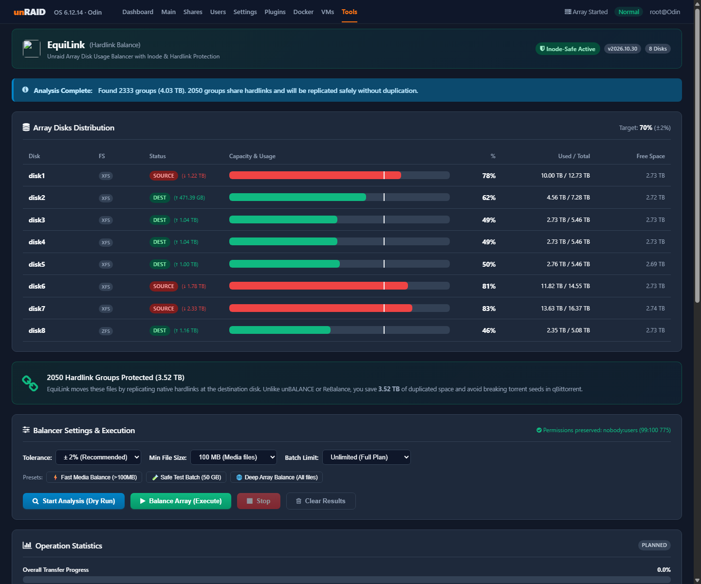
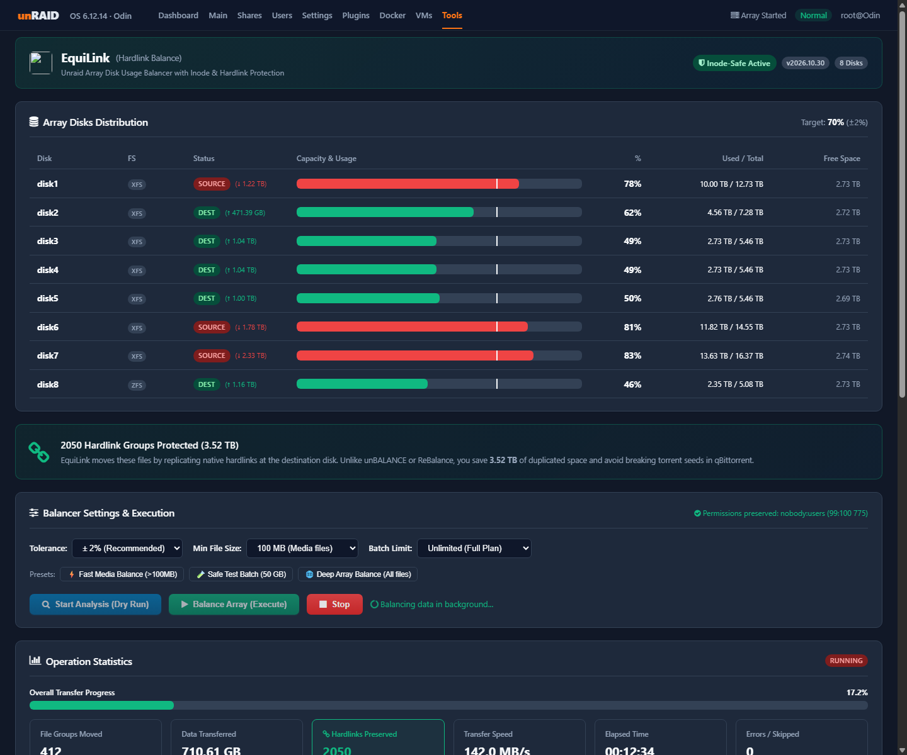
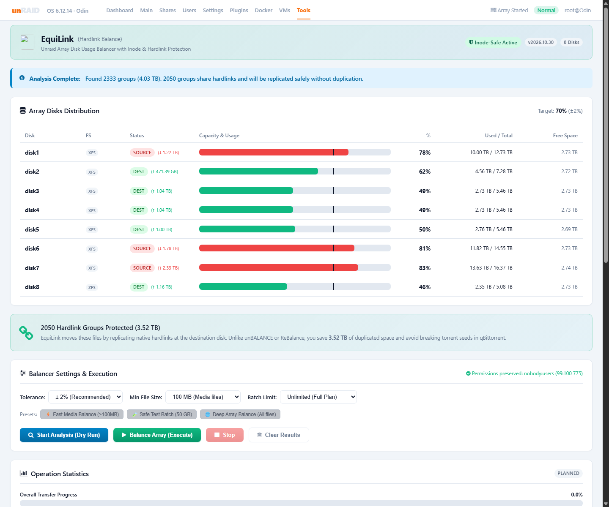

<p align="center">
  
</p>

<h1 align="center">EquiLink for Unraid ⚖️🔗</h1>
<h3 align="center">The Unraid array disk-usage balancer that never breaks hardlinks.</h3>

<p align="center">
  <a href="https://unraid.net"></a>
  <a href="LICENSE"></a>
  <a href="https://github.com/nemesbak/hardlink-balance/releases"></a>
  
</p>

---

## 📸 Screenshots

### 1. Analysis Mode (Dark Theme) — Real-Time Array Distribution & Zero-Duplication Shield


### 2. Live Balancing in Action — Real-Time Transfer Speed, ETA & Multi-Linked Rebuilding


### 3. Light Theme Support (Seamless Dynamix Integration)


---

## ⚡ The Problem with Traditional Balancers

If you use **qBittorrent** alongside media managers like **Radarr**, **Sonarr**, **Plex**, or **Jellyfin**, your media files share hardlinks. Hardlinks allow a downloaded video file in your torrent folder to exist simultaneously in your media library without consuming double disk space.

Existing Unraid plugins (such as *unBALANCE* or *ReBalance*) move files one-by-one with plain `rsync`:
* **They silently break every hardlinked pair across disks.**
* When a movie or episode is moved, its link to the active torrent is severed, resulting in **two distinct copies** on different drives.
* Space usage doubles, parity gets thrashed, and when qBittorrent attempts to manage or clean up completed torrents, it runs into `Permission denied` or creates orphan files.

```
Traditional Balancers (unBALANCE / ReBalance):
[Torrent Folder] ──(hardlink)──> [Media Library]
       │                                │
       ▼ (rsync moves file-by-file)     ▼
 [Disk 1: Remains]             [Disk 2: Duplicate Created!]
 ❌ RESULT: 2x DISK USAGE, BROKEN SEEDS, PERMISSION DENIED

EquiLink (Inode-Aware Engine):
[Torrent Folder] ──(shared inode st_dev:st_ino)──> [Media Library]
       │                                                  │
       └──────────────────┬───────────────────────────────┘
                          ▼ (atomic group transfer)
 [Disk 2: Copied primary file + Recreated native hardlinks (os.link)]
 ✅ RESULT: 1x DISK USAGE, ZERO DUPLICATION, 100% SEED INTEGRITY
```

---

## ✨ Features & Guarantees

| Feature | Description |
| :--- | :--- |
| **🛡️ Inode-Aware Grouping** | Walks source disks and groups files strictly by physical inode `(st_dev, st_ino)`. Files sharing disk blocks are always planned and moved as a single unit. |
| **🔗 Native Hardlink Rebuilding** | Replicates the primary file via `rsync -aX`, verifies file size, and recreates all secondary paths on the destination disk using native filesystem `os.link`. |
| **🚫 Collision Prevention Guard** | Proactively checks if destination file paths already exist before transferring. Never overwrites existing files. |
| **⚡ Concurrent Write Guard** | Compares `st_size` and `st_mtime` before and after transfer. If a file is modified mid-copy (e.g. active torrent download), it skips it and safely rolls back. |
| **🧹 Empty Directory Pruning** | Automatically prunes empty parent directory hierarchies on the source disk up to the share root after moving files. |
| **💾 ZFS & XFS Child Mount Support** | ZFS disks are measured at pool level, so child datasets (e.g. `/mnt/diskN/datos`) are counted. |
| **👤 Nobody:Users Ownership** | Automatically enforces `nobody:users` (99:100) and `0775` permissions on all newly created folders and files. |
| **🔍 Live Interactive Plan Search** | Real-time search bar and filter chips (*All*, *Hardlinks Only*, *Single Files*) to inspect the transfer plan instantly in the WebGUI. |
| **⏹️ Graceful Stop** | Halts execution cleanly after the currently active file group completes, ensuring zero partial or broken files. |

---

## 🚀 Installation

### Option 1: Via Unraid WebGUI (1-Click Install)
1. In your Unraid WebGUI, navigate to **Plugins** → **Install Plugin**.
2. Paste the following URL:
   ```text
   https://raw.githubusercontent.com/nemesbak/hardlink-balance/main/hardlink-balance.plg
   ```
3. Click **Install**.
4. The plugin will appear immediately under **Tools** → **EquiLink (Hardlink Balance)**.

### Option 2: Community Applications (Pending Moderation)
Once indexed, simply search for **`EquiLink`** or **`Hardlink`** in the Unraid **Apps** tab and click Install.

---

## 🖥️ WebGUI Quick Tour

* **Array Disks Distribution**: Real-time capacity bars with target utilization line (e.g. `Target: 69%`), `XFS` / `ZFS` filesystem badges, and delta transfer indicators (`↓ 2.29 TB` to shed, `↑ 1.22 TB` headroom).
* **Zero-Duplication Shield**: Prominently displays the exact number of hardlink groups and total GB protected from redundant cloning (e.g. `2,050 groups · 3.52 TB preserved`).
* **One-Click Presets**:
  * ⚡ **Fast Media Balance**: Filters files $>100\text{ MB}$, skipping tiny metadata (NFOs, subtitles) for maximum speed.
  * 🧪 **Safe Test Batch**: Caps transfers to 50 GB for a controlled first run.
  * 🌐 **Deep Array Balance**: Complete comprehensive balance across all files.
* **Live Activity Console**: Terminal output with colorized events (`MOVED`, `PLAN`, `WARNING`, `ERROR`) and a 1-click **Copy Log** button.

---

## ⌨️ CLI Usage (Optional)

EquiLink can also be executed directly from the Unraid terminal or via SSH:

```bash
# 1. Safe Simulation / Dry-run (does not move any data)
python3 /usr/local/emhttp/plugins/hardlink-balance/scripts/hardlink_balance.py --dry-run

# 2. Fast media analysis skipping files under 100 MB
python3 /usr/local/emhttp/plugins/hardlink-balance/scripts/hardlink_balance.py --dry-run --min-size-kb 102400

# 3. Safe execution capped to 50 GB
python3 /usr/local/emhttp/plugins/hardlink-balance/scripts/hardlink_balance.py --execute --limit-gb 50

# 4. Full balance excluding a specific disk (e.g. disk8)
python3 /usr/local/emhttp/plugins/hardlink-balance/scripts/hardlink_balance.py --execute --tolerance 2 --exclude-disks disk8

# 5. Gracefully stop a running instance
python3 /usr/local/emhttp/plugins/hardlink-balance/scripts/hardlink_balance.py --stop
```

### CLI Arguments Reference

| Argument | Type | Default | Description |
| :--- | :--- | :--- | :--- |
| `--dry-run` | Flag | Default | Build and summarize move plan without touching data. |
| `--execute` | Flag | False | Actually move files and rebuild hardlinks. |
| `--tolerance` | Integer | `2` | Target ±% variance across array disks (e.g. `2` means $69\% \pm 2\%$). |
| `--min-size-kb` | Integer | `0` | Skip files smaller than this threshold (e.g. `102400` = 100 MB). |
| `--limit-gb` | Float | None | Cap total transferred data in this run (e.g. `50`). |
| `--exclude-disks` | String | None | Comma-separated list of disks to exclude (e.g. `disk8,disk9`). |
| `--stop` | Flag | False | Send graceful SIGTERM to halt the running balancer cleanly. |

---

## ❓ Frequently Asked Questions (FAQ)

#### Does this break torrent seeding in qBittorrent?
**No.** That is the entire reason EquiLink was created. When EquiLink moves a file that is seeded in qBittorrent and organized in your Jellyfin/Radarr library, it copies the primary file and recreates all other paths on the destination drive using native filesystem hardlinks (`os.link`). qBittorrent continues seeding without rechecking.

#### What happens if a transfer is interrupted or stopped?
EquiLink uses a two-phase commit: only after the copy is completely finished and all hardlinks are verified on the destination drive does it remove the originals from the source drive. If stopped, the in-flight file finishes cleanly and execution halts. No partial or corrupt files are ever created.

#### Is ZFS supported?
**Yes.** On ZFS disks EquiLink reads the pool's used/available (`zfs list`), so child datasets such as `/mnt/diskN/datos` are included.

---

## 📄 License

MIT License. Designed and maintained for the Unraid community.

## Active-download safety

Torrent ↔ library hardlinks are moved together, and a folder is **skipped** when any of these is true:

- a file in it was modified or got a new hardlink in the last `MIN_AGE_MIN` minutes (default 60);
- a file is open for writing by any process (qBittorrent, *arr, HandBrake… detected through `/proc`, including shfs);
- a file is a partial download (`.!qB`, `.part`, …);
- a hardlink of a file lives somewhere the scan can't see (link count mismatch).

Right before deleting the source, every link is re-checked (same inode, link count, size, mtime, no writers).
Runs are refused while Mover, a parity check or another rsync between array disks (unBALANCE) is active.
Seeding keeps working: qBittorrent reads the file through `/mnt/user`, which follows it to the new disk.

## Settings

`/boot/config/plugins/hardlink-balance/hardlink-balance.cfg`:

| Key | Default | |
|---|---|---|
| `WEBHOOK` | empty | Alertmanager-style webhook for end-of-run alerts |
| `RUNS_DIR` | `/boot/config/plugins/hardlink-balance/runs` | JSON report per executed run |
| `MIN_AGE_MIN` | `60` | Skip folders touched in the last N minutes |
