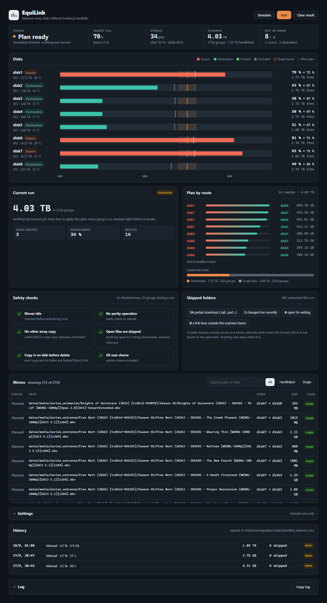
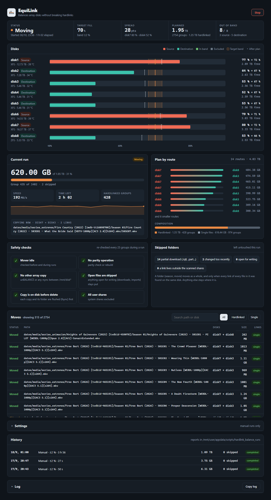
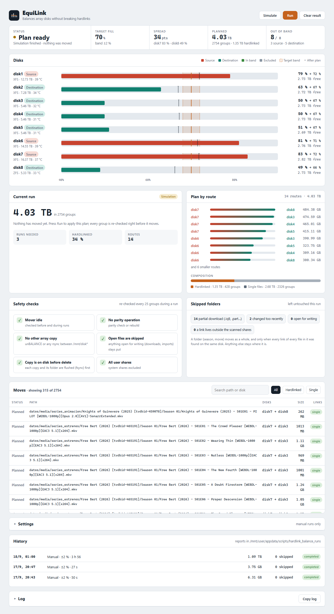
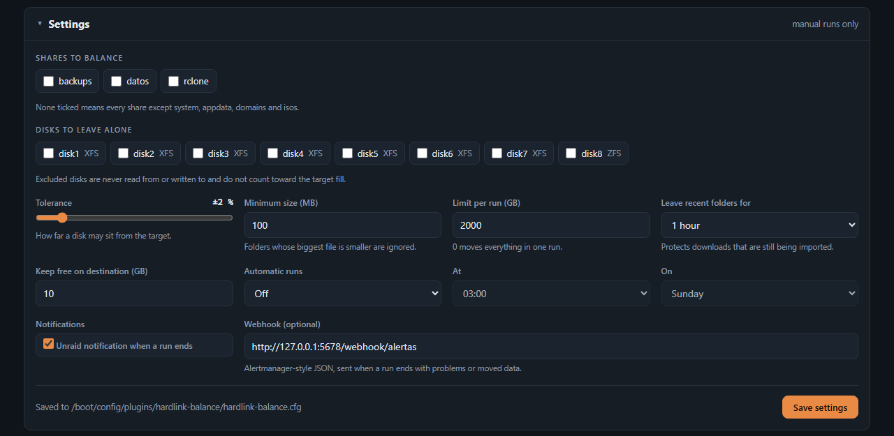
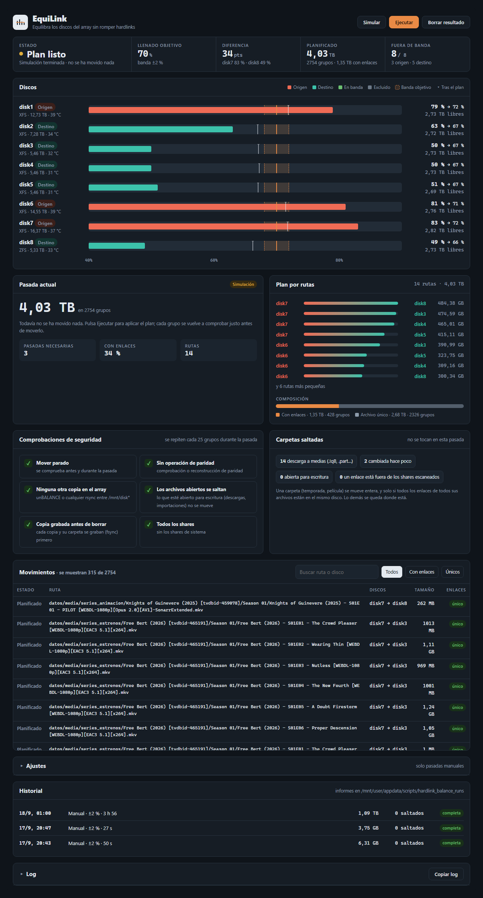

<p align="center">
  
</p>

<h1 align="center">EquiLink for Unraid</h1>
<p align="center"><b>Balances the fill of your array disks without ever breaking a hardlink.</b></p>

<p align="center">
  <a href="https://unraid.net"></a>
  <a href="LICENSE"></a>
  
  
</p>



## Why

If qBittorrent seeds a file and Sonarr, Radarr, Plex, Jellyfin or Emby show the same file from your library, those two paths are **one file with two names** (a hardlink). It takes space once.

Classic balancers move one path at a time with `rsync`. The two names end up on different disks, the file now exists twice, and your "balanced" array is fuller than before.

EquiLink groups every path by inode, moves the whole group to the same destination disk and recreates the links there. The file still takes space once, seeding keeps working and the library does not notice.

```
Plain rsync balancer                         EquiLink
torrents/Movie.mkv ─┐                        torrents/Movie.mkv ─┐
                    ├─ 1 inode on disk1                          ├─ 1 inode on disk1
media/Movie.mkv  ───┘                        media/Movie.mkv  ───┘
        │ moves only media/                          │ moves the group
        ▼                                            ▼
disk1: torrents/Movie.mkv   (copy 1)         disk3: torrents/Movie.mkv ─┐ 1 inode,
disk3: media/Movie.mkv      (copy 2)         disk3: media/Movie.mkv   ──┘ links kept
```

## Screenshots

| Run in progress | Light theme |
| :---: | :---: |
|  |  |



The page follows your Unraid theme (dark for Black and Gray, light for White and Azure) and your Unraid language.

## Languages

English and Spanish. By default the page uses the language set in **Settings → Display Settings**; you can force one under **Settings → Language** in EquiLink. Unknown languages fall back to English.

To add a language, copy the `es` block of `DICT` in `HardlinkBalance.page`, translate the right-hand side and add the code to the language list. Pull requests welcome.



## What you get

- **Disks at a glance.** Each disk's fill against the target band, which disks will send or receive data, and where each one ends up after the plan.
- **Simulate before you move.** A simulation shows every planned move, the disk-to-disk routes and how much of it is hardlinked. Nothing moves until you press Run and confirm.
- **Live progress.** Data moved, speed, time left, the file being copied and the status of each move.
- **Safety checks on screen.** Mover, parity operations and other array copies are shown and re-checked during the run.
- **History.** Every run that moved data leaves a report: when, how much, how long and whether anything needs a look.
- **Parallel copies.** Several copies at once, each between its own pair of disks, so no disk ever reads or writes two things at the same time. On an array without parity, three copies move data about three times faster.
- **Automatic runs.** Daily, weekly or monthly, with an optional cap per run so a big rebalance spreads over several nights.
- **Notifications.** In the Unraid notification bell and, optionally, a webhook.

## Safety model

EquiLink was written for arrays that are in use while it runs: downloads arriving, *arr apps importing, media servers streaming.

**What moves.** Whole folders (a season, a movie), oldest first. A folder moves only if every link of every file in it was found on that disk. A folder is skipped when:

- a file in it changed or got a new hardlink recently (default: last hour);
- a file is open for writing by any process (detected through `/proc`, including Unraid's `shfs`);
- a file is a partial download (`.!qB`, `.part`, `.crdownload`, …);
- a file has a link outside the scanned shares (the link count does not match).

**How it moves.**

1. Checks that no destination path already exists. Nothing is ever overwritten.
2. Copies the file with `rsync` to a hidden temp file on the destination and checks the size.
3. Flushes the copy to disk (`fsync`), re-checks the source (same inode, link count, size, mtime, no writers) and publishes it with a no-clobber `link()`.
4. Recreates every other link next to it and flushes the new folder entries.
5. Only then removes the originals and prunes empty folders.

If anything changes on the way, the group is skipped and the source stays as it was. Stop aborts the copy in flight and deletes its temp file. Temp files left by a crash or power cut are removed at the start of the next run.

**When it refuses to run.** While the Mover, a parity check or rebuild, or another `rsync` between `/mnt/disk*` (unBALANCE, for example) is active. These checks repeat every 25 groups during a run.

**Where it puts data.** Never on a disk excluded from that share (`shareInclude` / `shareExclude` in the share settings), never on a disk you told EquiLink to leave alone, and always leaving free space on the destination (10 GB by default).

## Fits different setups

| Your setup | What to set |
| :--- | :--- |
| One `data` share with torrents and media together (TRaSH layout) | Defaults work. |
| Several shares, but only some should move | Tick them under **Shares to balance**. |
| A disk you want to keep as it is (archive, near failure, different speed) | Tick it under **Disks to leave alone**. It is not touched and does not count toward the target. |
| Large array, short quiet hours | Set **Limit per run** (e.g. 500 GB) and **Automatic runs** at night. |
| No parity, several disks to fill or empty | Set **Copies at once** to 2–4. Each disk still takes part in one copy at a time. |
| Parity disk | Keep **Copies at once** at 1: every write also goes to parity, so parallel copies do not help. |
| Downloads that take hours to import | Raise **Leave recent folders for** to 6 hours or 1 day. |
| Small disks, or ones that fill up fast | Raise **Keep free on destination**. |
| ZFS disks in the array | Supported. Capacity is read from the pool (`zfs list`), so child datasets such as `/mnt/disk8/data` count. |
| XFS or Btrfs disks | Supported. |
| Parity or no parity | Both work. With parity, moves are slower because every write updates parity. |
| No internet at boot | Supported. Plugin files are cached on the flash drive and checked by MD5. |

System shares (`system`, `appdata`, `domains`, `isos`) and pool-only shares are never scanned.

## Install

**Plugins → Install Plugin**, paste and press Install:

```text
https://raw.githubusercontent.com/nemesbak/hardlink-balance/main/hardlink-balance.plg
```

The page appears under **Tools → EquiLink (Hardlink Balance)**. Start with **Simulate**.

## Settings

Everything is set from the page and saved to `/boot/config/plugins/hardlink-balance/hardlink-balance.cfg`. Uninstalling keeps this file and your run history.

| Key | Default | Meaning |
| :--- | :--- | :--- |
| `SHARES` | empty | Shares to balance, comma separated. Empty = all array shares except system shares. |
| `EXCLUDE_DISKS` | empty | Disks never read from or written to. |
| `TOLERANCE` | `2` | How far (in %) a disk may sit from the target fill. |
| `MIN_SIZE_MB` | `100` | Folders whose biggest file is smaller are ignored. |
| `LIMIT_GB` | `0` | Maximum data per run. `0` = no cap. |
| `MIN_AGE_MIN` | `60` | Leave folders changed in the last N minutes. |
| `HEADROOM_GB` | `10` | Free space always left on a destination disk. |
| `PARALLEL` | `1` | Copies at once (1–4). A disk never takes part in two copies at the same time. |
| `LANGUAGE` | `auto` | `auto` (same as Unraid), `en` or `es`. |
| `SCHEDULE` | `off` | `off`, `daily`, `weekly` or `monthly`. |
| `SCHEDULE_HOUR` / `SCHEDULE_DOW` | `3` / `0` | Hour of automatic runs; weekday for weekly runs (0 = Sunday). |
| `UNRAID_NOTIFY` | `yes` | Send a notification to the Unraid bell when a run ends. |
| `WEBHOOK` | empty | Alertmanager-style JSON webhook, sent when a run ends. |
| `RUNS_DIR` | `/boot/config/plugins/hardlink-balance/runs` | One JSON report per run that moved data. |

## Command line

```bash
E=/usr/local/emhttp/plugins/hardlink-balance/scripts/hardlink_balance.py

python3 $E --dry-run                        # simulate with your saved settings
python3 $E --execute --limit-gb 50          # move at most 50 GB
python3 $E --execute --parallel 3           # three copies at once (arrays without parity)
python3 $E --execute --exclude-disks disk8  # leave disk8 alone this time
python3 $E --stop                           # stop a running balance
python3 $E --guards                         # Mover / parity / rsync state as JSON
```

Command-line flags (`--tolerance`, `--min-size-kb`, `--min-age-min`, `--limit-gb`, `--exclude-disks`, `--parallel`) override the saved settings for that run only.

## Tests

Two suites build throwaway XFS disks in RAM and run as root on the server:

- `tests/test_hlb.sh` (19 checks): links kept, content identical, recent, open and partial files left alone, no overwrite on collision, stop in the middle of a copy, share exclusions, crash leftovers and the share filter.
- `tests/test_parallel.sh` (15 checks): real concurrency, never two copies on one disk, every torrent ↔ library pair still linked, stop with several copies in flight, the engine's own copies never mistaken for another tool's, and a foreign `rsync` between disks blocks the run.

```bash
bash tests/test_hlb.sh && bash tests/test_parallel.sh
```

## FAQ

**Does seeding break?** No. qBittorrent reads through `/mnt/user`, which finds the file on its new disk, and the link to the library is kept. No recheck is needed.

**Can I use it while people are streaming?** Yes. Reading a file that is being moved is fine; the media server keeps the old copy open until it closes it. Disks are busier, so schedule big runs at night.

**What does "on both disks" mean in the report?** The copy was made but an original could not be removed (for example, permissions). Nothing is lost; the file exists twice until you remove one. You also get a notification.

**Why is a disk not getting emptier?** If a process holds a moved file open (a torrent client seeding it, for example), its space is freed when the process closes it.

## License

MIT.
